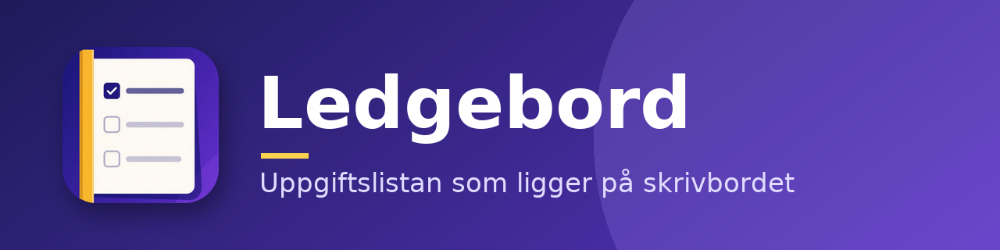

  

# Ledgebord

**Ledgebord är en liten uppgiftslista som ligger på skrivbordet.** Skriv en uppgift, tryck Enter — klart. Appen
påminner dig, tar emot uppgifter från mail och sparar allt i en mapp på din egen dator. Gratis, utan konto och utan moln.

*English: a lightweight desktop to-do widget for Windows (Python + PySide6), with reminders, mail import, calendar view and payment plans.*

---

## 🚀 Kom igång (Windows)

1. **Ladda ner:** klicka på den gröna knappen **Code → Download ZIP** här på GitHub och packa upp mappen var du vill.
2. **Första gången:** dubbelklicka på **`FORSTA_START.bat`**. Den installerar Python om det saknas, installerar
   tilläggen som behövs och startar Ledgebord. Det tar någon minut.
3. **Nästa gång:** dubbelklicka på **`STARTA_HAR.bat`** (inget svart fönster) — eller bocka i *Starta med datorn* i
   tray-menyn så startar appen själv.

> Har du redan Python används den som den är — **Python uppdateras inte**. Tilläggen uppdateras en gång i veckan.
> macOS och Linux: kör `./starta.sh` (se [manualen](docs/MANUAL.md#-windows--macos--linux)).

## ✨ Det här kan den

| | |
|---|---|
| ➕ **Snabbt** | Skriv och tryck Enter. Skriv `Skicka offert start måndag` så fattar den startdatumet. Ctrl+Alt+N från var som helst. |
| 🏷 **Ordning** | Prioritet, taggar med färger, förfallodatum, delmoment, återkommande uppgifter, sök, arkiv som sparas för alltid. |
| 🔔 **Påminnelser** | Påminner tills uppgiften är klar. Siffra på tray-ikonen visar hur många som väntar. |
| 📆 **Kalender** | Månadsvy som visar vilka dagar som är tunga, med röda dagar. Skicka uppgifter till Google Calendar eller `.ics`. |
| 📧 **Mail** | Högerklicka ett mail i Thunderbird → uppgift. Datum i mailet blir påminnelser. |
| 💸 **Delbetalning** | Dela en faktura i flera betalningar — varje del blir en uppgift med datum och belopp. |
| 💰 **Belopp** | Belopp på uppgifter med summor per månad och tagg ("att fakturera"). |
| 📝 **Anteckningar** | Längre text per uppgift. Telefonnummer och adresser blir klickbara (ring, SMS, Google Maps). |
| 🖥 **Skrivbordet** | Ligger bakom dina fönster, eller överst om du vill. Dockar mot skärmkanten. Följer Windows ljusa/mörka tema. |
| 🔄 **Uppdatering** | Hittar nya versioner själv och uppdaterar tyst. Dina uppgifter och inställningar rörs aldrig. |
| 💾 **Säkert** | Automatiska backuper, felloggar och självläkning. Bara en instans åt gången — startar du igen öppnas den som kör. |

Alla detaljer, steg för steg: **[docs/MANUAL.md](docs/MANUAL.md)**.

## ❓ Vanliga frågor

**Var sparas mina uppgifter?** I appmappen: `js\` (uppgifter och bilagor), `data\` och `loggar\`. Ingenting skrivs utanför
mappen — utom genvägen för *Starta med datorn* i Windows Startup-mapp, om du slår på den.

**Hur uppdaterar jag?** Det sker av sig självt två gånger per dygn. Vill du kolla direkt: tray-ikonen → **Sök ny version**.

**Hur tar jag bort appen?** Stäng den (tray → Avsluta), slå av *Starta med datorn* och radera mappen. Vill du spara
uppgifterna, kopiera `js\` först.

**Appen syns inte.** Klicka på tray-ikonen (vid klockan), eller starta appen igen — då öppnas fönstret.

**Något gick fel.** Tray-menyn → **🧯 Öppna felloggen**, eller **🩺 Skapa felrapport…**.

## 📚 Mer

- [Manual](docs/MANUAL.md) — alla funktioner, genvägar och inställningar
- [Thunderbird-tillägget](THUNDERBIRD.md) — skicka mail till Ledgebord
- [Google Calendar](GOOGLE_CALENDAR.md) — koppla kalendern
- [Ikoner och logotyp](docs/MANUAL.md#-namn-och-ikon) · [Kodstruktur](docs/MANUAL.md#-kodstruktur-för-den-som-ändrar-koden)

## 💖 Stöd projektet

Ledgebord är gratis och utan reklam. Donationer är helt frivilliga:
[PayPal](https://paypal.me/Rickard3dPrint) · [Ko-fi](https://ko-fi.com/tokke2)

---

Copyright © Rickard Längkvist, 2025–2026. Licens: MIT (se [`LICENSE`](LICENSE)).
